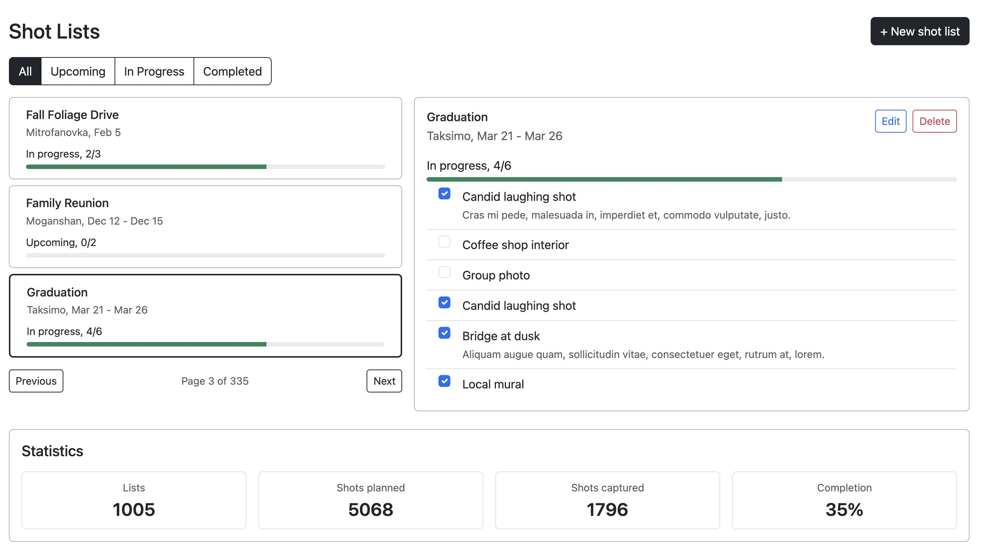
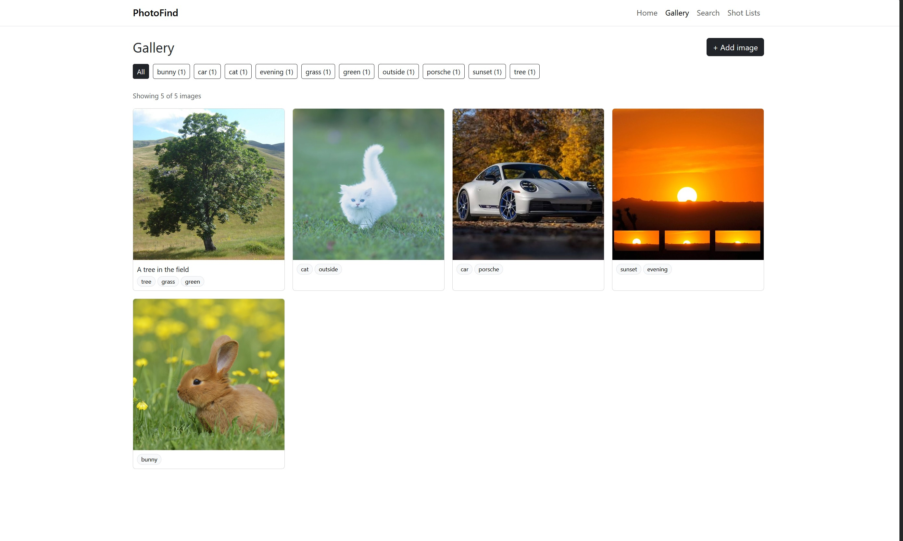

# PhotoFind

A web app for organizing, finding, and planning photos, built with Node, Express, MongoDB, and vanilla JavaScript.

- **Live site:** [PhotoFind on Render](https://photofind-lhvb.onrender.com)
- **Design documents:**
  - Shot Lists (Milena): [Design document](docs/design-document-shotlists.pdf)
  - Images and Search (Rishabh): [Design document](docs/design-document-search.pdf)
- **Video demo and presentation:** [Watch on YouTube](ADD-LINK-HERE)
- **Slides:** [Presentation](https://docs.google.com/presentation/d/1BLYR7r4rk_WIs3N6ubYqKLufcZmeoD5yGF6nn5ba8NQ/edit?usp=sharing)





## Project Objective

The object was to build a full-stack web application with Node + Express + MongoDB + HTML5 frontend that helps people keep track of their photos before and after they take them. PhotoFind has two independent features, each with its own MongoDB collection:

- **Images and Search** (`gallery.html`, `search.html`): add images, tag them, and search by what you remember
- **Shot Lists** (`shotlists.html`): plan the photos you want to take on a trip, and check them off as you go

## Features

### Shot Lists (Milena Perez-Gerus)

- Create a shot list with a name, location, dates, and the shots you want (one per line)
- Check off shots as you take them, with a progress bar on each list
- Filter lists by status: all, upcoming, in progress, or completed
- Browse 1,000+ lists with pagination (Previous / Next)
- Edit a list's name, location, and dates
- Delete a list, with a confirmation popup message
- Statistics across all lists: total lists, shots planned, shots captured, and completion rate
- **How to use:** open Shot Lists in the navigation bar, click **+ New shot list** to create a trip, click any list to see its shots, and tick the checkboxes as you take each photo.

### Images and Search (Rishabh Kumar)

- Add an image by uploading a file or pasting an image URL, with up to 10 tags and an optional description
- Uploads are resized in the browser on a canvas (longest side 1024px, JPEG) before saving, so a multi-megabyte photo is stored as about 100 KB
- Gallery grid with tag filter buttons showing how many images have each tag, and **Load more** pagination (24 images at a time)
- Image detail page to edit an image's tags and description, or delete it with a confirmation
- Search by what you remember: results are ranked by a **% match** score, and the matching words are highlighted
  - Each search word scores 1 for an exact tag, 0.75 for a word in the description, and 0.4 for a partial match (e.g. "sun" in "sunset"); the image's score is the average over all search words
  - Common words like "the" and "on" are ignored
- The selected tag and search query are kept in the URL, so filtered views can be shared and the Back button works
- **How to use:** open **Gallery** in the navigation bar and click **+ Add image**. Choose **Upload file** or **Paste URL**, add comma-separated tags like `beach, dog, sunset`, and click **Save**. Back in the gallery, click a tag to filter, or click an image to edit or delete it. To find an image, open **Search** and type what you remember, e.g. `dog on the beach`.

## GenAI Usage

### Milena Perez-Gerus

Model: Claude Opus 5.5

- Learning: explanations of Express routes, the MongoDB Node.js driver, `fetch` request options, using map as an array method, and differences between bootstrap classes.
- Data: MongoDB queries used to clean up Mock data dates and statuses
- Writing: help drafting the README

### Rishabh Kumar

Model: Claude Opus 5.5

- Learning: help understanding Express routes, uploading images to MongoDB and resizing before uploads
- Testing and verification: reviewing code, testing API routes, and fixing small UI bugs it found
- Dataset: creating the images json file using Wikimedia Commons

## Tech Requirements

- HTML5, CSS3, and vanilla JavaScript (ES6 modules), with the Canvas API for resizing uploads
- [Bootstrap 5.3](https://getbootstrap.com/) via CDN
- [Node.js](https://nodejs.org/) + [Express](https://expressjs.com/) (ES modules)
- [MongoDB](https://www.mongodb.com/) with the native Node.js driver (no Mongoose)
- ESLint and Prettier

## How to Install and Use

1. Clone the repository:

```bash
   git clone https://github.com/mimiperezg/photofind.git
   cd photofind
```

2. Install the dependencies:

```bash
   npm install
```

3. Start MongoDB with Docker:

```bash
   docker run --name mongodb -p 27017:27017 -v mongodata:/data/db -d mongodb/mongodb-community-server:latest
```

4. Import the mock data: in MongoDB Compass, connect to `mongodb://localhost:27017`, create a database named `photofind` with a collection named `shotLists`, and import `data/shotlists.json`. Then create a collection named `images` in the same database and import `data/images.json` (1,025 sample images).
5. Start the server:

```bash
   npm start
```

6. Open [http://localhost:3000](http://localhost:3000). By default, the app connects to `mongodb://localhost:27017`. To use another database, such as MongoDB Atlas, set the `MONGODB_URI` environment variable, or put it in a `.env` file in the project folder (it is git-ignored, so your credentials stay private):

```bash
   MONGODB_URI=mongodb+srv://<user>:<password>@<cluster>.mongodb.net/
```

Use `npm run dev` instead of `npm start` to restart the server automatically when files change.

The sample images in `data/images.json` are quality-rated photos from [Wikimedia Commons](https://commons.wikimedia.org/wiki/Category:Quality_images), linked by URL and used under their respective free licenses. Their descriptions come from the photo titles.

## Authors

- **Milena Perez-Gerus**: [Homepage](https://mimiperezg.github.io/homepageMilenaPerezGerus/) · [GitHub](https://github.com/mimiperezg)
- **Rishabh Kumar**: [Homepage](https://k-rishabh.github.io/) · [GitHub](https://github.com/k-rishabh)

## Class

Created for [CS 5610 Web Development](https://johnguerra.co/classes/webDevelopment_online_fall_2026/) at Northeastern University, taught by John Alexis Guerra Gómez.

## License

This project is licensed under the [MIT License](LICENSE).
